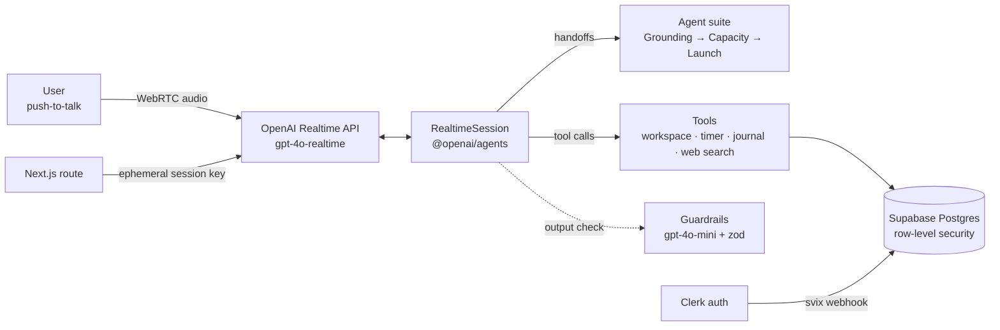

# Mizan Haque

I build AI systems that work alongside people: voice agents, search and retrieval over messy data, and ML experiments where I'm clear about what the evidence actually shows.

Right now I'm building **[Accai](https://accai.io)**, a voice-first multi-agent coach that helps people start, stay with and get back to hard tasks. It started as my AI MSc project. I've also worked on search and computer-vision projects at Sellafield.

[Website](https://mizan.black) · [Case studies](https://mizan.black/experience) · [LinkedIn](https://www.linkedin.com/in/mizanhaque/) · [Substack](https://worldviewxtc.substack.com) · [YouTube](https://www.youtube.com/@worldviewxtc)

---

## Building now

### Accai: voice-first multi-agent support for task-level agency

[`accai1109`](https://github.com/zan-h/accai1109) · [Case study](https://mizan.black/projects/building-agency-with-ai) · [accai.io](https://accai.io)

You hold push-to-talk and talk to a small team of specialised voice agents. Each one handles a stage of the work: one gets you started, one scopes the task, one keeps you going. They hand off to each other, start timers, write to a shared workspace and check in partway through a focus block. I started from OpenAI's realtime-agents reference app and turned it into a multi-tenant product with auth, persistence and a built-in research harness.

- **Agent suites:** 13 suites defined, 10 enabled (energy and focus, flow sprints, deep work, writing, video production, evidence-based study and more). A suite is a typed config: a root agent, a handoff graph, tools and guardrails. Adding a new one follows a written protocol and template.
- **Realtime voice:** WebRTC transport, Whisper transcription and a server route that mints ephemeral Realtime sessions, so the API key never reaches the browser.
- **Guardrails:** a moderation classifier (`gpt-4o-mini`, zod-typed structured output) checks every suite's agent output. A stage-aware classifier that flags wrong-stage replies and premature handoffs is also implemented.
- **Timer tools:** agents start, pause and stop visible timers, with optional check-ins at 25%, halfway, the final stretch and completion.
- **Data layer:** versioned SQL migrations with rollbacks, including RLS policies, an atomic tab-update function, voice sessions and transcripts, a daily work journal, feedback and experiments. Clerk users sync to Supabase through verified webhooks.
- **Research harness:** consent modals, questionnaires and an experiment orchestrator are built into the app, so a user study runs inside the product itself.

**Pilot results:** 14/14 live-session responses were positive for getting started. In 9 matched 60-minute sessions, self-reported task progress rose from 4.0 to 5.44 (out of 6), and the prototype averaged 8.33/10. The pilot was small, relied mostly on self-report and had no control group, so I read these results as evidence that the approach is feasible, not proof that it works.

`TypeScript` `Next.js 16` `React` `OpenAI Realtime + Agents SDK` `Supabase` `Clerk` `Zustand` `Tailwind` `Framer Motion` `Vercel`

Earlier steps: [`accailp`](https://github.com/zan-h/accailp), the first landing page with Supabase email capture and a PRD for an ACT-informed productivity coach (Dec 2024), and [`pomodorotimer`](https://github.com/zan-h/pomodorotimer), a vanilla-JS focus timer with intention-setting.

---

## Work projects (Sellafield)

### Solr as a second brain for legacy fileshares

[Case study + interactive Solr lab](https://mizan.black/projects/solr-as-a-second-brain) · [`solrbrain`](https://github.com/zan-h/solrbrain)

Over the years, migrated fileshares had filled up with duplicate work packs, sensitive files nobody had noticed and metadata stuck inside documents. I redesigned the problem around retrieval: every file becomes a Solr document with fields (path, owner, modified date, type, extracted text), so you search first, narrow with facets and always see the source path. LLM questions come after that, grounded in sources you can check. The use cases came from real roles (remediation data manager, data steward, remote-handling engineer, information architect). Classification and compliance (ISO 27001, GDPR, DPA 2018) were in scope from the start.

`solrbrain` (FileMind) is my open prototype of the ingestion layer:

- Python package (Poetry) that manages an Apache Tika server: startup, health checks, text and metadata extraction
- Recursive filesystem crawler, plus a FastAPI backend with WebSocket progress streaming to a web UI
- 74 pytest tests across the crawler, extractor, Tika service and API, with Black, Flake8 and isort in pre-commit and MyPy for type checking
- Graph (Neo4j) and LLM (LangChain) modules scaffolded for the next stage

`Apache Solr` `Apache Tika` `Python` `FastAPI` `WebSockets` `pytest`

### PCM waste-can inspection: a no-code computer-vision roadmap

[Case study + interactive demo](https://mizan.black/projects/pcm-waste-can-inspection)

The original question was whether computer vision could spot anomalies in PCM waste-can X-rays. I narrowed it to whether the data was ready for ML at all. I mapped the specialist inspection workflow, then translated Alteryx Intelligence Suite's image-classification pipeline (image input → processing → labelling → sampling → recognition) to this problem.

- Three anomaly classes (liquids, powders, dense objects). Liquids are framed as a multi-view problem because a single angle rarely settles it.
- Phased dataset plan (500 → 2,000 → 5,000 labelled frames) with a 60/20/20 train/validation/holdout split
- Controlled experiment design: full-frame context vs. bounding-box localisation, compared on precision, recall, F1 and confusion patterns for each class
- Build / collect / pause decision criteria, with transfer learning to cut the early data requirement
- Estimated ~4.7 specialist hours a week returned by automating triage and document cross-checks, while high-risk decisions stay with specialists

`Alteryx Intelligence Suite` `Computer vision` `Transfer learning` `Experiment design`

---

## Research and ML

### Social alignment with a Furhat robot (Heriot-Watt, team of 10)

[Case study + trace explorer](https://mizan.black/projects/social-alignment-with-furhat-robots) · [Team repo](https://github.com/hwu-social-alignment-robots-2025/alignment-social-robots)

A human-robot interaction study: does a ten-minute conversation with an LLM-driven Furhat robot shift how people rank things, for both factual and contestable ranking tasks?

- Kotlin Furhat skill (Gradle, Furhat Commons 2.7.0, OpenAI Java client, Ktor, Hoplite YAML config, Gson). Each turn runs listen → log → build prompt → call LLM → speak → log.
- The experimental condition (vanilla control vs. a Big-Five "extrovert" persona prompt) is selected through config. Output is capped at 50 tokens and listening ends after 800 ms of silence to keep the robot responsive.
- Every turn is written to durable JSON traces, because live dialogue history is reset each session.
- 27 participants, analysed with linear mixed models in R. Alignment rose after interaction (time effect +3.98, p < .001), with a condition × time interaction of +4.69 (p < .001).

`Kotlin` `Furhat` `OpenAI` `Prompt engineering` `R / LMM` `HRI`

### Emotional state classification from EEG

[Case study](https://mizan.black/projects/emotion-ai-eeg-classification)

Classifying valence, arousal, dominance and liking from EEG and physiological signals.

- DEAP (32 EEG channels plus peripheral signals) for the main study, and DREAMER (14-channel consumer headset) for a Keras GRU prototype with early stopping
- PCA kept 90% of variance with 664 components. SVM, logistic regression, decision tree and neural-network baselines were evaluated on accuracy, precision, recall and F1.
- The neural network led on all four dimensions: 74.87% F1 on valence and a best of 80.58% F1 on liking. The last 15 seconds of each trial carried the cleanest signal.
- Clear limits stated: the next version needs participant-held-out validation, multimodal fusion and calibrated uncertainty.

`Python` `Keras` `PCA` `Signal processing` `Model comparison`

### Training a neural network with particle swarm optimisation

[Interactive explainer](https://mizan.black/projects/ann-pso-explainer)

A configurable ANN trained by PSO instead of backpropagation, on banknote authentication (1,372 samples, 4 wavelet features). Each particle is a full flattened weight vector, and cross-entropy is its fitness.

- Experiments ran in phases: activation functions (Leaky ReLU best), PSO hyperparameters and architecture. The best architecture was a single wide hidden layer, `[4, 8, 1]` (49 parameters).
- Final configuration: 50 particles, 60 iterations, neighbourhood size 14, c1 = 3, c2 = 1, inertia 0.5, reaching **99.12% mean accuracy (σ 0.0053)** over repeated runs

`Python` `scikit-learn` `Swarm optimisation` `Interactive visualisation`

### Neural machine translation with attention

[Interactive walkthrough](https://mizan.black/projects/machine-translation-demo)

An English → French seq2seq model on Multi30k: an LSTM encoder-decoder with dot-product and bilinear attention (with padding masks), greedy, top-k and top-p decoding, BLEU evaluation and attention heatmaps for inspecting the alignments.

`PyTorch` `Seq2seq` `Attention` `BLEU`

### Evolutionary robotics in Webots

[`intelligentrobotics`](https://github.com/zan-h/intelligentrobotics)

An e-puck robot learns to navigate a T-maze using a light cue. A genetic algorithm (tournament selection, elitism, 70% crossover, mutation) evolves the weights of an MLP controller, and a supervisor process averages each genotype's fitness over repeated trials. The fitness function weights forward motion (35%), wall avoidance (25%), anti-spin stability (25%) and right-side light detection (15%). The controller also detects the junction from its proximity sensors and a blinking light from the variance in its light sensors.

`Python` `Webots` `Genetic algorithms` `Neuroevolution`

---

## Toolkit

- **Languages:** TypeScript, Python, SQL, JavaScript
- **AI / ML:** OpenAI Realtime and Agents SDK, prompt engineering, PyTorch, Keras, scikit-learn, PCA, evolutionary and swarm optimisation
- **Search / data:** Apache Solr, Apache Tika, Supabase/Postgres (RLS, migrations), Alteryx
- **Web:** Next.js, React, FastAPI, WebRTC, WebSockets, Tailwind
- **Practice:** experiment design, user studies, evaluation design
